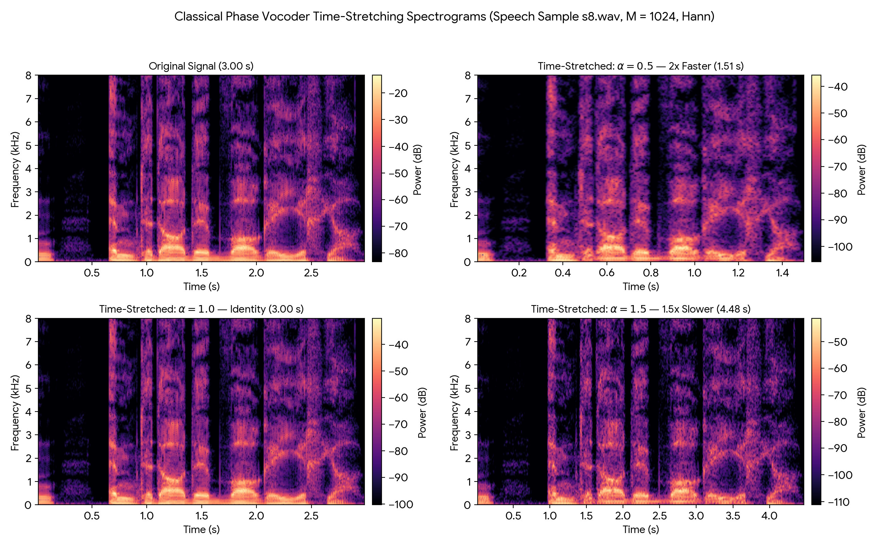
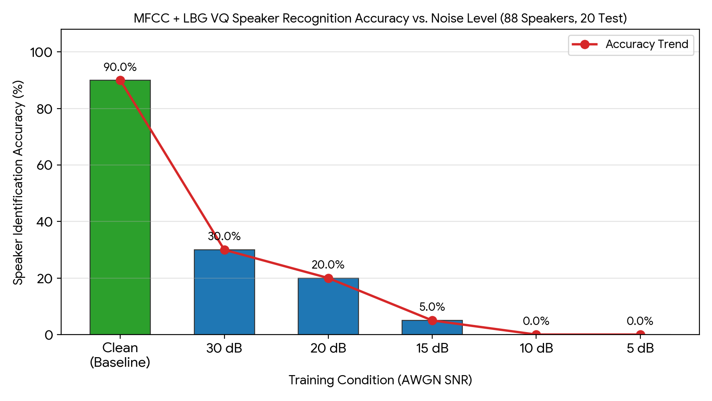
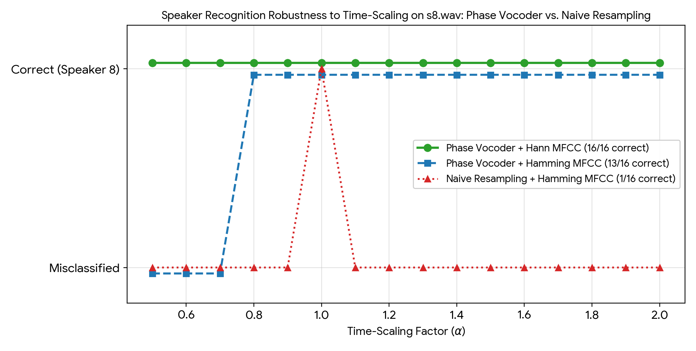

# DSP Audio Processing: Classical Phase Vocoder & MFCC–VQ Speaker Recognition

A two-part **MATLAB** Digital Signal Processing project implementing:
1. **Classical STFT Phase Vocoder** for pitch-preserving audio time-stretching ($\alpha = 0.5, 1.0, 1.5$).
2. **Automatic Speaker Recognition System** built from scratch using **MFCC** feature extraction and **Linde–Buzo–Gray (LBG) Vector Quantization** across **88 enrolled speakers**, evaluated under clean, time-warped, and AWGN-corrupted conditions.

Developed for the **Digital Signal Processing (DSP)** course at the Department of Electrical Engineering, Sharif University of Technology.

---

## Part 1: Classical Phase Vocoder (`phase-vocoder/`)
Implements STFT-based time-scale modification ($M = 1024$, Hann window, $75\%$ overlap) with bin-wise phase unwrapping, instantaneous frequency deviation estimation, phase accumulation across synthesis hops ($H_s = \text{round}(\alpha H_a)$), and overlap-add squared-window normalization.



### Perceptual & Spectral Analysis
| Stretching Factor ($\alpha$) | Effect | Observed Characteristics |
| :---: | :--- | :--- |
| **$\alpha = 1.0$** | Identity (1.0x) | Near-transparent STFT reconstruction; serves as the distortion baseline. |
| **$\alpha = 0.5$** | Time Compression (2.0x faster) | Preserves pitch and harmonic tracks well; slight loss of fine temporal spacing with minimal transient smearing. |
| **$\alpha = 1.5$** | Time Expansion (1.5x slower) | Most susceptible to classical phase-vocoder artifacts ("phasiness" from loss of vertical phase coherence across harmonics and transient smearing on plosives/consonants). |

---

## Part 2: MFCC + LBG VQ Speaker Recognition (`speaker-recognition/`)
Implements an end-to-end speaker identification pipeline on a corpus of **88 training speakers** (`train/s1.wav`–`s88.wav`) and **20 test utterances** (`test/s1.wav`–`s20.wav`):
* **Pre-processing & Framing:** RMS normalization, pre-emphasis ($H(z) = 1 - 0.9375z^{-1}$), $25\text{ ms}$ framing with $50\%$ overlap, and Hamming / Hann windowing.
* **Feature Extraction (`mfcc.m`, `melfb.m`):** Power spectrum via `nextpow2` FFT, 20-channel triangular Mel filterbank, log compression, and Type-II DCT extracting 12 cepstral coefficients ($c_1$–$c_{12}$).
* **Acoustic Modeling (`vqlbg.m`, `disteu.m`):** 64-centroid speaker codebooks trained via iterative binary-splitting LBG Vector Quantization; classification assigns each test utterance to the speaker minimizing average frame-to-centroid Euclidean distortion.

### Benchmark Results

#### 1. Clean & AWGN-Corrupted Training Accuracy (88 Speakers, 20 Test Utterances)
| Condition | Clean Baseline | SNR = 30 dB | SNR = 20 dB | SNR = 15 dB | SNR = 10 dB | SNR = 5 dB |
| :--- | :---: | :---: | :---: | :---: | :---: | :---: |
| **Accuracy** | **90.0% (18/20)** | 30.0% | 20.0% | 5.0% | 0.0% | 0.0% |



#### 2. Time-Scaling Robustness (`test/s8.wav`, $\alpha \in [0.5, 2.0]$)
Comparing pitch-preserving **Phase Vocoder** time-stretching against naive rational resampling demonstrates why preserving the spectral envelope is critical for MFCC-based speaker recognition:
* **Naive Resampling (Hamming MFCC):** **1 / 16** correct (fails whenever $\alpha \neq 1.0$ due to formant & pitch shifting).
* **Phase Vocoder + Hamming MFCC:** **13 / 16 (81.2%)** correct across $\alpha \in [0.8, 2.0]$.
* **Phase Vocoder + Hann MFCC:** **16 / 16 (100.0%)** correct across the full $\alpha \in [0.5, 2.0]$ range.



---

## Project Structure
```text
DSP-Audio-Processing-Project/
├── phase-vocoder/
│   ├── main.m                        # Time-stretching driver & spectrogram generator
│   └── phaseVocoder.m                # Classical STFT Phase Vocoder function
├── speaker-recognition/
│   ├── main.m                        # Clean, time-warping & AWGN evaluation suite
│   ├── src/
│   │   ├── mfcc.m                    # MFCC feature extraction
│   │   ├── melfb.m                   # Mel-spaced triangular filterbank
│   │   ├── vqlbg.m                   # Linde-Buzo-Gray (LBG) VQ trainer
│   │   ├── disteu.m                  # Pairwise Euclidean distance
│   │   ├── train.m                   # Clean codebook enrollment
│   │   └── train_noisy.m             # AWGN-corrupted codebook enrollment
│   ├── train/                        # 88 speaker enrollment WAV files (s1.wav..s88.wav)
│   └── test/                         # 20 speaker test WAV files (s1.wav..s20.wav)
├── results/
│   ├── phase_vocoder_spectrograms.png
│   ├── speaker_recognition_noise_snr.png
│   └── speaker_recognition_time_warping.png
├── .gitignore
└── README.md
```

## How to Run
Requires **MATLAB** (Signal Processing Toolbox used for `spectrogram` and `resample`; core Phase Vocoder, MFCC, LBG VQ, and AWGN injection are implemented directly in MATLAB):

```matlab
% Part 1: Run Phase Vocoder
cd('phase-vocoder');
main;

% Part 2: Run Speaker Recognition Benchmarks
cd('../speaker-recognition');
main;
```
